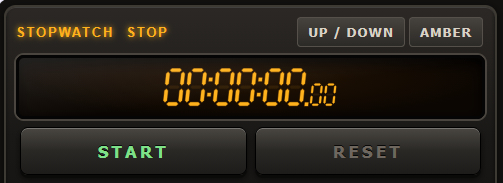
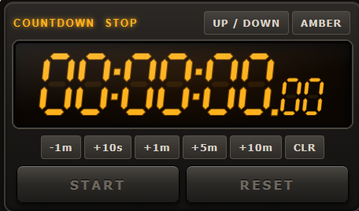
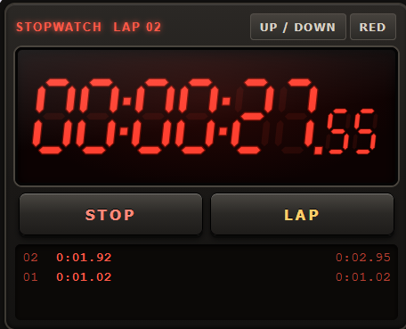

# MSFS Timers

The base is provided by https://github.com/bymaximus/msfs2020-toolbar-window-template

There are a number of timers available for MSFS. The standard EFB has one, and Sky4sim too.

However, they don't appear on all the pages of those panels, which is  a bit annoying.

The goal of this package is to provide a timer which can be opened at will, so that you can see it when you look at your maps and so on.

## Using it

A small in-game panel (stopwatch icon in the toolbar) with a vintage LED display, `HH:MM:SS` plus hundredths.

* **Stopwatch** - `START` / `STOP`, `LAP` while running (the lap list shows the split and the total), `RESET` when stopped.
* **Countdown** - switch with `UP / DOWN`, set the length with `-1m  +10s  +1m  +5m  +10m` (`CLR` to zero it), then `START`. At zero **the display flashes and beeps**; any click on the panel silences it, `RESET` rearms it.
* `AMBER` cycles the LED colour (amber, red, green).
* The state is saved: the timer keeps counting (in real time) while the panel is closed, and is still there after a restart of the sim.
* The panel can be resized; the lap list and header give way when it gets small.

Keyboard shortcuts (the panel must have the focus, i.e. click on it first): `Space` / `Enter` start-stop, `L` lap, `R` / `Backspace` reset, `M` mode, `T` colour.

The default size only displays the stopwatch. If you enlarge the window, it will be large enough for the countdown timer.

## Development

* `dev/index.html` runs the panel in a normal browser (serve the repository root over http, e.g. `python -m http.server`).
* `dev/test.html` runs the tests of the timer model (`tm/timer.js`).
* `build.bat` rebuilds the `.spb` with the MSFS SDK, `deploy.bat` installs the package in Community (`deploy.bat stage` only stages it), `release.bat` makes the zip, `clean.bat` removes generated files.
  `fspackagetool` sometimes does not exit after a successful build: if so, end it from the task manager; the `.spb` is already in `timer-panel\Build\Packages	imer-panel\Build\`.

## About the bymaximus package

I have started working on this flight computer using a generic template for MSFS plugin by [Maximus](https://github.com/bymaximus/msfs2020-toolbar-window-template). You can go to the linked site and make a donation to him if you are happy with this plugin. 
